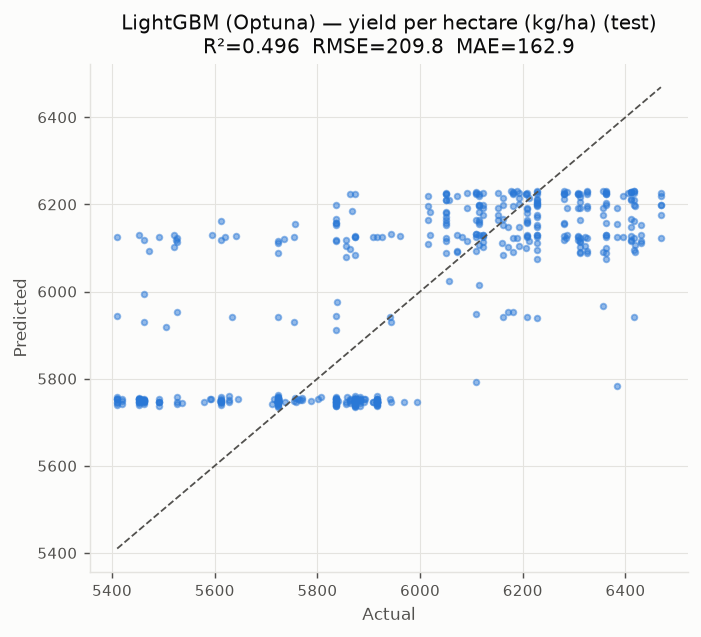
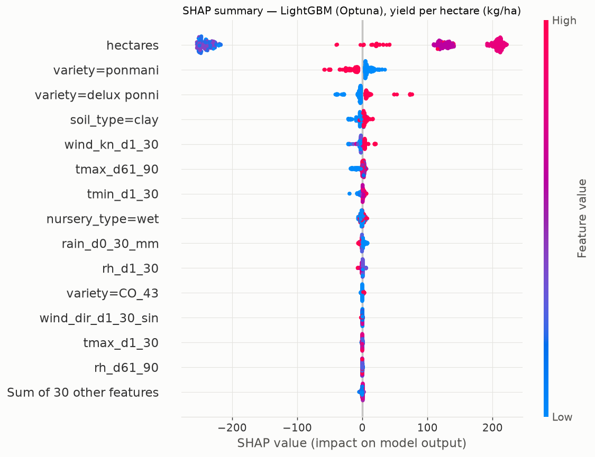
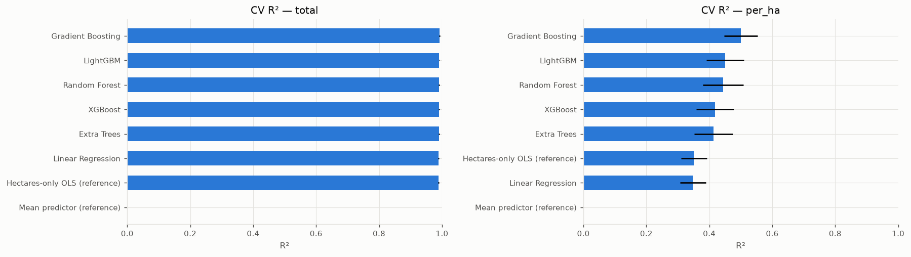
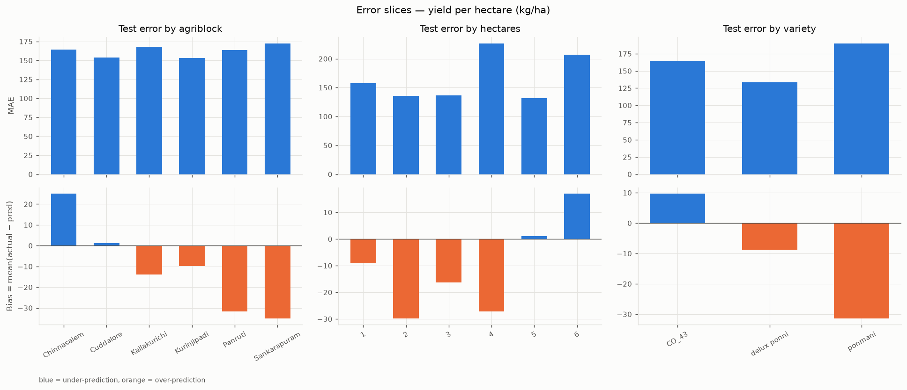
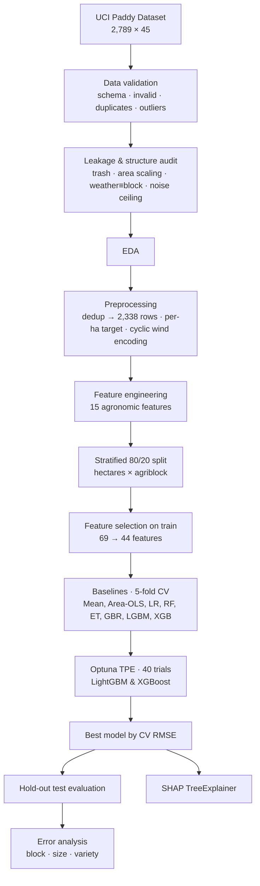

# Paddy Yield Prediction using Machine Learning

End-to-end tabular regression pipeline for paddy (rice) yield on the public **UCI Paddy Dataset**:
validation → leakage audit → EDA → feature engineering → feature selection → baselines →
Optuna-tuned LightGBM / XGBoost → SHAP → error analysis. CPU only; the full pipeline runs in about 6 minutes.

> **Headline results, held-out test set**
>
> | Target | Best model | R² | RMSE | MAE | MAPE |
> |---|---|---|---|---|---|
> | Total yield (kg) | LightGBM + Optuna | **0.991** | 881 kg | 624 kg | 2.77 % |
> | Yield per hectare (kg/ha) | LightGBM + Optuna | **0.496** | 210 kg/ha | 163 kg/ha | 2.77 % |
>
> A total-yield R² of ≈ 0.99 looks impressive, but a one-variable linear model on
> **farm area alone already reaches R² = 0.988**. The agronomically meaningful target,
> yield per hectare, is predictable only to R² ≈ 0.50, against an estimated noise ceiling of ≈ 0.59.

## Results at a glance

<table>
<tr><td width="50%"><br><sub>Predicted vs actual yield per hectare (test set)</sub></td><td width="50%"><br><sub>SHAP: what drives yield per hectare</sub></td></tr>
<tr><td width="50%"><br><sub>Cross-validated R² of all models</sub></td><td width="50%"><br><sub>Error by slice of the test set</sub></td></tr>
</table>

All figures are in [`reports/figures/`](reports/figures/). Logs: [`reports/logs/`](reports/logs/) (training and evaluation). Metrics: [`reports/metrics/`](reports/metrics/).

---

## 1. Dataset

| | |
|---|---|
| Name | **Paddy Dataset**, UCI Machine Learning Repository, id **1186** |
| Creator | Muthukumaran Subramaniyan |
| DOI / citation | [10.24432/C55W3J](https://doi.org/10.24432/C55W3J): Subramaniyan, M. (2023). *Paddy Dataset*. UCI ML Repository |
| Page | https://archive.ics.uci.edu/dataset/1186/paddy+dataset |
| Download | https://archive.ics.uci.edu/static/public/1186/paddy+dataset.zip → `data/raw/paddydataset.csv` |
| License | CC BY 4.0 |
| Region | Six agricultural blocks of Cuddalore / Kallakurichi districts, Tamil Nadu, India |

`src/data_loader.py` re-downloads the file automatically if `data/raw/` is empty.
(`ucimlrepo` cannot import this dataset, so the official zip is fetched directly.)

### Dataset statistics

| Item | Value |
|---|---|
| Rows / columns | **2,789 × 45** (44 predictors + target) |
| Target | `Paddy yield(in Kg)`: total harvest per farm record, **kg** (5,410 – 38,814, mean 22,518) |
| Derived target | `yield_kg_per_ha` = yield / hectares (5,410 – 6,469 kg/ha, mean 5,985, sd 289) |
| Numeric / categorical | 36 / 8 |
| Categorical | `Agriblock` (6), `Variety` (3: CO_43, delux ponni, ponmani), `Soil Types` (2), `Nursery` (2), 4 × wind direction (16-point compass) |
| Geographic | `Agriblock` (no coordinates) |
| Temporal | **None.** `D1_D30 … D91_D120` are crop-stage windows within one season, not dates. No year/season column |
| Missing values | 0 |
| Invalid values | 0 (no negatives, RH within 0–100, Tmin ≤ Tmax, all wind codes valid) |
| Exact duplicate rows | **451 (16.2 %)** → 2,338 unique rows |
| Unique feature configurations | 410 (375 of them appear with different yields) |
| Outliers (1.5×IQR) | 0 global outliers in yield/ha; 77 rows are outliers *within* their farm-size group. Kept: they are inside the observed agronomic range with no evidence of recording error. Only `wind_kn_d61_90` flags (one block's value) |

Variable groups: farm size (`Hectares`); management inputs (seed rate, land-prep in tonnes, nursery
area, DAP @20d, thiobencarb weedicide @28d, urea @40d, potash @50d, micronutrients @70d, pesticide @60d);
stage rainfall + "AI" water (4 windows); min/max temperature, wind speed, wind direction and relative
humidity (4 × 30-day windows); `Trash(in bundles)`; target.

---

## 2. Architecture



---

## 3. Leakage and structure analysis (the core finding)

Because R² ≈ 0.99 is suspicious, the data was audited before any modelling
(`src/validation.py`, `reports/metrics/leakage_report.json`).

| Check | Finding | Action |
|---|---|---|
| Post-harvest variable | `Trash(in bundles)` is a harvest by-product (r = 0.957 with yield) | **Excluded.** It equals hectares × a variety constant (80/90/100 bundles/ha, 1 exception), so here it adds no extra signal, but it would not exist at prediction time |
| Target scaling | Yield is a *total*; `corr(yield_kg, hectares) = 0.994` | Model both total and **per-hectare** yield |
| Input quantities | All 10 input columns are **exactly hectares × constant** (1 unique per-ha value each). Every farm uses identical doses per hectare | Nitrogen/fertilizer effects **cannot be estimated** from this data. Redundant columns removed |
| Weather | All 28 weather columns are a deterministic function of `Agriblock` (6 profiles in total) | Weather effects are inseparable from location; SHAP on weather = block identity |
| Rain vs "AI" | rain + AI is constant per stage (40 / 458 / 417 / 125 mm) | "AI" is complementary water; redundant |
| Duplicates | 451 exact duplicate rows | Removed **before** splitting |
| Future / time | No date or season column | Time-based split impossible |
| Aggregation leakage | No target-derived aggregates present. All engineered features use inputs only and are row-wise (no target encoding) | None needed |
| Irreducible noise | 41 % of per-ha variance lies between rows with *identical* features | Per-ha R² ceiling ≈ **0.59** |

**Leakage ablation** (5-fold CV, default LightGBM, `reports/metrics/leakage_ablation.csv`):

| Setting | Total R² | Per-ha R² |
|---|---|---|
| Raw incl. duplicates + trash (naive) | 0.9917 | **0.488** |
| Deduplicated + trash | 0.9905 | 0.430 |
| Deduplicated, no trash (all features) | 0.9905 | 0.435 |
| Compact: hectares + agriblock + variety + soil + nursery | 0.9907 | 0.448 |
| Hectares only (OLS) | 0.9887 | 0.352 |

Duplicates inflate per-ha CV R² by about 0.05. The 44 source columns contain about **5 variables' worth of information**.

### Split strategy

There is no time column, so a temporal split is impossible. The pipeline deduplicates, then makes an
80/20 hold-out split stratified on hectares × agriblock (1,870 train / 468 test). All selection and
tuning use 5-fold CV on the training set only. Sensitivity check on train (default LightGBM):

| Scheme | Total R² | Per-ha R² |
|---|---|---|
| Random 5-fold | 0.9911 | 0.450 ± 0.059 |
| Leave-one-agriblock-out | 0.9911 | 0.483 ± 0.062 |
| Group by management configuration | 0.9909 | 0.453 ± 0.039 |

The schemes agree, so random splitting (after deduplication) does not leak through location here.

---

## 4. Feature engineering

15 features, all documented in `src/features.py::FEATURE_DOCS`. Fertilizer grades assumed: Urea
46 % N, DAP 18-46-0, MOP 60 % K₂O. The source gives no unit for DAP/Urea/Potash, so kg is assumed.

| Feature | Definition | Outcome |
|---|---|---|
| `n_applied_kg` | 0.46·Urea + 0.18·DAP | ≡ hectares (r = 1.0) → dropped |
| `n_per_ha`, `p2o5_per_ha`, `k2o_per_ha` | nutrient intensity | **constant** → dropped |
| `n_to_k_ratio` | N : K₂O | constant → dropped |
| `total_rain_mm`, `total_irrigation_mm`, `rain_share` | season water | ≡ one stage-rain column → dropped |
| `tmean_season`, `gdd_base10` | thermal time | GDD ≡ tmean → dropped |
| `diurnal_range_mean`, `heat_stress_windows` (Tmax ≥ 35 °C) | temperature stress | kept, ~0 importance |
| `rh_mean`, `wind_mean_kn`, `rain_x_tmean` | weather aggregates / interaction | kept, ~0 importance |
| wind direction | sin/cos of compass bearing (encoding, not counted) | kept |

Feature engineering **did not add predictive signal**. The variation these features would capture
(dose per hectare, season weather) is either constant or already identical to location. This is reported as a result.

## 5. Feature selection

Constant-feature and |r| ≥ 0.99 redundancy filters, fit on the training split only. Mutual
information and LightGBM gain were used for ranking (`reports/metrics/feature_scores_*.csv`).

* **69 encoded features → 44 (36.2 % reduction)**, with *identical* CV performance
  (per-ha 0.4501 → 0.4501; total 0.9911 → 0.9911).
* MI and gain both rank `hectares` first by a wide margin, then variety and soil.

---

## 6. Models and Optuna

Baselines: Mean predictor, Hectares-only OLS (reference), Linear Regression, Random Forest, Extra
Trees, Gradient Boosting, LightGBM, XGBoost.

Optuna: TPE sampler (seed 42), **40 trials per model per target**. The objective is 5-fold CV RMSE on train;
the test set is never touched. Search spaces cover every requested parameter:
LightGBM (`n_estimators, learning_rate, num_leaves, max_depth, min_child_samples, subsample,
colsample_bytree, reg_alpha, reg_lambda`) and XGBoost (`n_estimators, max_depth, learning_rate,
min_child_weight, subsample, colsample_bytree, reg_alpha, reg_lambda`). Each study takes about 1 minute on CPU.
Optuna favoured many shallow trees (5–6 leaves) with a low learning rate (≈ 0.005–0.009).

## 7. Results

### Yield per hectare (kg/ha), the agronomic task

| Model | CV R² | Test R² | Test RMSE | Test MAE | Test MAPE % |
|---|---|---|---|---|---|
| Mean predictor (ref.) | −0.001 | −0.002 | 295.7 | 255.7 | 4.32 |
| Hectares-only OLS (ref.) | 0.351 | 0.351 | 238.0 | 187.0 | 3.17 |
| Linear Regression | 0.348 | 0.352 | 237.8 | 186.6 | 3.17 |
| Random Forest | 0.444 | 0.379 | 232.8 | 181.9 | 3.09 |
| Extra Trees | 0.413 | 0.346 | 238.8 | 185.1 | 3.14 |
| Gradient Boosting | 0.501 | 0.483 | 212.4 | 165.2 | 2.81 |
| LightGBM | 0.450 | 0.394 | 230.0 | 180.5 | 3.07 |
| XGBoost | 0.418 | 0.361 | 236.2 | 183.5 | 3.12 |
| **LightGBM (Optuna)** ★ | **0.513** | **0.496** | **209.8** | **162.9** | **2.77** |
| XGBoost (Optuna) | 0.507 | 0.494 | 210.2 | 164.3 | 2.79 |

### Total yield (kg)

| Model | CV R² | Test R² | Test RMSE | Test MAE | Test MAPE % |
|---|---|---|---|---|---|
| Hectares-only OLS (ref.) | 0.9888 | 0.9882 | 1010.3 | 752.1 | 3.77 |
| Linear Regression | 0.9888 | 0.9882 | 1007.0 | 754.2 | 3.83 |
| Random Forest | 0.9909 | 0.9893 | 962.2 | 690.1 | 3.09 |
| Extra Trees | 0.9904 | 0.9888 | 983.6 | 701.4 | 3.14 |
| Gradient Boosting | 0.9917 | 0.9908 | 891.9 | 633.4 | 2.83 |
| LightGBM | 0.9911 | 0.9894 | 955.8 | 682.8 | 3.05 |
| XGBoost | 0.9906 | 0.9888 | 981.0 | 695.3 | 3.11 |
| **LightGBM (Optuna)** ★ | **0.9919** | **0.9910** | **880.6** | **623.9** | **2.77** |
| XGBoost (Optuna) | 0.9918 | 0.9911 | 874.6 | 623.3 | 2.77 |

★ = selected by CV RMSE (not by test score). Optuna improved per-ha CV RMSE from 212.9 to 200.2 (LightGBM)
and from 219.0 to 201.4 (XGBoost).

## 8. SHAP (LightGBM + Optuna, test set)

| Source variable | Share of mean \|SHAP\|, per-ha | Total |
|---|---|---|
| hectares (farm size) | **82.8 %** | **97.1 %** |
| variety | 9.2 % | 1.6 % |
| soil type | 1.7 % | 0.3 % |
| nursery type | 0.8 % | 0.1 % |
| location (agriblock + all weather columns) | 5.5 % | 0.9 % |
| nitrogen / fertilizer | **0 %** (constant per ha or ≡ hectares) | 0 % |

The top predictors are **farm size and variety**. Nitrogen, rainfall and temperature are *not*
dominant. Fertilizer cannot matter here because every farm applies the same dose per hectare, and rainfall and
temperature appear only as location identifiers. `ponmani` lowers predicted yield; `delux ponni` raises it.
Plots: `reports/figures/shap_*_{summary,bar,grouped_importance,waterfall_typical,waterfall_worst}.png`.

## 9. Error analysis (per-ha, test)

* Errors are roughly symmetric: 244 under- vs 224 over-predictions. Median |error| is 134 kg/ha; p90 is 321 kg/ha.
* **Largest errors are low-yield 4–6 ha farms** (actual ≈ 5,400–5,500, predicted ≈ 6,100). The model
  predicts the group mean and has no feature explaining those farms' under-performance.
* By farm size, 4 ha (226) and 6 ha (207) have the highest MAE; 2, 3 and 5 ha have the lowest (131–137).
* By variety, `ponmani` has the highest MAE (190) with an over-prediction bias of −31 kg/ha.
* By block, MAE ranges only 153–172 kg/ha, so there is no strong regional failure. Temporal error analysis is impossible (no time column).

## 10. Limitations

* The input columns are almost entirely **farm-size multiples or block constants**, so causal or
  agronomic conclusions (nitrogen response, rainfall effect) **cannot** be drawn from this dataset.
* There are only 6 weather profiles, so weather generalisation to a new location is untested in any meaningful way.
* The per-ha ceiling of ≈ 0.59 means 40 % of yield variance is unexplained by any recorded variable.
* Units of DAP/Urea/Potash/micronutrients are not given in the source (kg assumed). "AI" and "LP" are undocumented
  abbreviations, interpreted from the data (AI complements rain to a fixed per-stage total).
* The single season and single region limit external validity.

## 11. Reproducibility

```bash
cd Paddy-Yield-Prediction
python -m venv .venv
.venv\Scripts\activate            # Windows   (source .venv/bin/activate on Linux/macOS)
pip install -r requirements.txt

python -c "from src.data_loader import download_raw; download_raw()"   # fetch the UCI data (not committed)
python scripts/train.py            # ~6 min CPU: validation, EDA, selection, CV baselines, Optuna (40 trials)
python scripts/evaluate.py         # hold-out test metrics, SHAP, error analysis
pytest                             # 10 data/leakage/pipeline tests

python notebooks/build_notebooks.py                                     # regenerate notebooks
jupyter nbconvert --to notebook --execute --inplace notebooks/0*.ipynb  # execute them
```

* Seeds are fixed (42) for the split, CV folds, models and Optuna. `python scripts/train.py --trials 10` gives a quick run.
* Verified with Python 3.12, scikit-learn 1.9, LightGBM 4.7, XGBoost 3.4, Optuna 5.0, SHAP 0.52, pandas 3.0.

## Project structure

```
data/raw/                 paddydataset.csv, downloaded from UCI (not committed)
data/processed/           train.csv, test.csv written by training (not committed)
notebooks/                01_eda · 02_feature_engineering · 03_baselines · 04_optuna · 05_shap
src/config.py             paths, column schema, seeds, budgets
src/data_loader.py        download + load + clean names
src/validation.py         schema, invalid values, duplicates, outliers, leakage diagnostics
src/preprocessing.py      dedup, per-ha target, wind encoding, stratified split, encoder
src/features.py           engineered features, redundancy filter, MI, model importance
src/models.py             baseline zoo + LightGBM/XGBoost factories
src/tuning.py             Optuna search spaces and CV objective
src/evaluation.py         metrics, CV, diagnostic plots, error analysis
src/eda.py · explain.py · plotting.py   EDA figures, SHAP, shared plot style
models/                   best_model_{total,per_ha}.joblib, Optuna studies, preprocessor (written by training, not committed)
reports/figures/          30 figures      reports/metrics/   all tables / JSON      reports/logs/   train + evaluate logs
tests/                    pytest suite
scripts/                  train.py · evaluate.py
.github/workflows/ci.yml  tests on every push (downloads the public dataset first)
```
